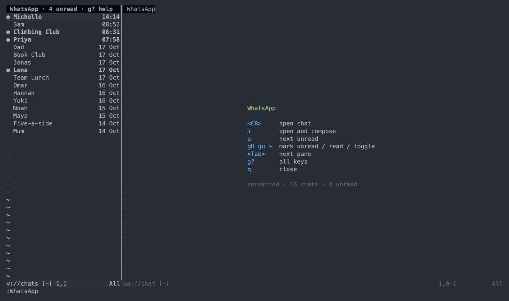
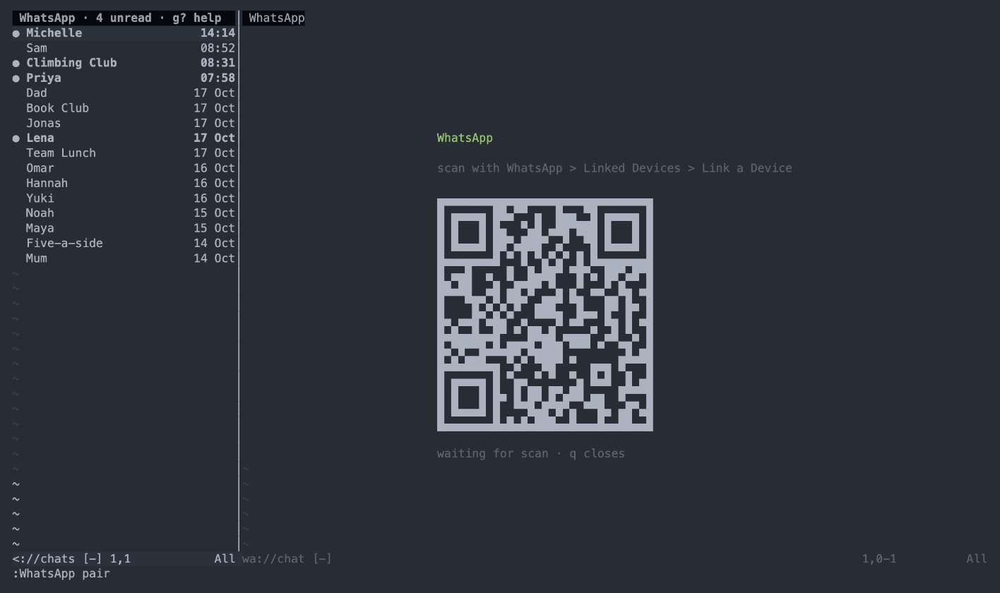
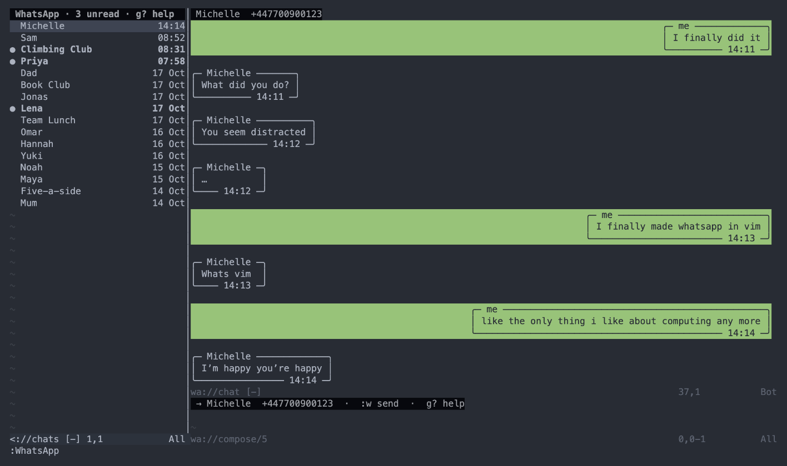
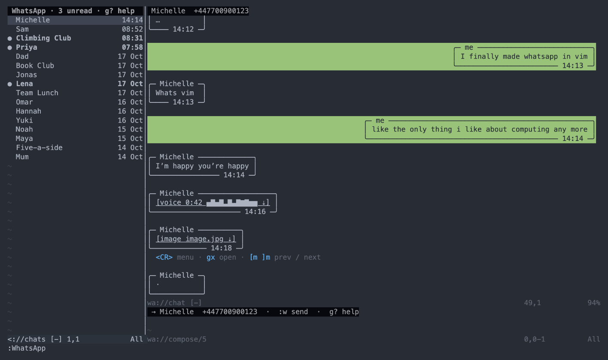

# whatsapp.nvim

WhatsApp in Neovim. 100% human written code, without AI assistance, all in less than 200 bytes of Bash (see [`whatsapp.nvim.sh`](./whatsapp.nvim.sh)). Uses an experimental compiler so comes with negative warranty and entirely at your own risk.

https://github.com/user-attachments/assets/1d78afec-1443-4e5d-ab55-ece2732e22b8

## Quickstart

Install via your favourite plugin manager:

```vim
" vim-plug
Plug 'dwmkerr/whatsapp.nvim', { 'rtp': 'dist', 'do': 'make -C dist' }
```

```lua
-- lazy.nvim
{
  "dwmkerr/whatsapp.nvim",
  build = "make -C dist",
  config = function()
    vim.opt.rtp:append(vim.fn.stdpath("data") .. "/lazy/whatsapp.nvim/dist")
    require("whatsapp").setup()
  end,
}
```

Run `:WhatsApp pair`, then go to WhatsApp > Settings > Linked Devices to scan the QR code and pair. Run `:WhatsApp` at any time to open the WhatsApp view, or start Neovim straight into it with `nvim +WhatsApp`.

## Features

**Setup and Pairing**

When you run `:WhatsApp` you'll get a splash screen showing the most essential shortcuts:



Use the `:WhatsApp pair` command to connect. On your mobile go to Settings > Linked Devices > Link a Device and scan the code shown in the right-hand pane. `:WhatsApp logout` unlinks the device again and forgets the local session.



**Chats and Messages**

The list of chats is shown on the left. Threads with unread messages are shown in bold. There are a few convenient helpers:

- `<CR>` opens the chat under the cursor, `i` opens it and starts composing
- `u` jumps to the next unread chat
- `f` cycles the filter on the line under the title: all, unread, groups (`<CR>` on that line does the same)
- `gU` / `gu` / `~` mark unread / read / toggle, mirrored to your phone (as a reminder, think of read as lowercase and unread as uppercase)
- `<Tab>` / `<S-Tab>` cycle between the list, the conversation and the compose pane
- `R` replies to the message under the cursor, `r` reacts to it
- `K` loads older messages, `L` toggles between bubbles and plain lines
- `:w` in the compose pane sends; multi-line messages work
- `g?` shows every key and command in the right-hand pane, `q` returns

Keys that act on the conversation also work from the chat list, so a shortcut never depends on which pane has focus.



**Attachments**

Attachments show as a tag in the message: `[image photo.jpg ⇣]`, `[video clip.mp4 0:12 ⇣]`, and voice notes as duration plus waveform. `⇣` means not downloaded yet, `✓` means the file is in the local cache. `<CR>` opens a small menu (download, open, copy path), `gx` downloads if needed and opens in the default application, and `[m` / `]m` move between attachments. The target attachment carries a hint with these keys under it.



Please be careful. If someone has sent something malicious then in the worst case opening it could lead to code execution. There are some best-effort protections[^1] but be mindful: every open asks for confirmation.

**Images**

Images are not shown inline yet; `gx` opens them in your image viewer. Inline rendering for terminals that support the Kitty graphics protocol is tracked in [#8](https://github.com/dwmkerr/whatsapp.nvim/issues/8).

**Other Bits & Pieces**

- When new messages come in for a chat you are not viewing, a notification is shown via `vim.notify` (the command line by default, or whatever your notification plugin does). `notify = false` in `setup()` silences it.
- The "…is typing" bubble appears under the last message while you have that chat open and the terminal focused, like the phone. In that state contacts see you as online, which is what makes WhatsApp send the typing events.
- Each chat keeps its own unsent draft and reply target until Neovim exits.

## Contributing

Please feel free to share updates. If possible, also update the original instructions in [`whatsapp.nvim.sh`](./whatsapp.nvim.sh).

There are open issues for ideas I've not got around to, here are some suggestions:

- [#4](https://github.com/dwmkerr/whatsapp.nvim/issues/4) unread message count per chat
- [#6](https://github.com/dwmkerr/whatsapp.nvim/issues/6) transcribe voice notes locally
- [#7](https://github.com/dwmkerr/whatsapp.nvim/issues/7) configurable opener per media type
- [#8](https://github.com/dwmkerr/whatsapp.nvim/issues/8) inline images for terminals that can handle it

## Building from Source

Check [`whatsapp.nvim.sh`](./whatsapp.nvim.sh) to build from source. For convenience, the pre-compiled version is in the [`./dist/`](./dist) folder.

## Developer Guide

Run from a local clone:

```sh
git clone https://github.com/dwmkerr/whatsapp.nvim.git
cd whatsapp.nvim
# Compile the plugin (needs Go and a C compiler).
make -C dist build

# Don't forget to change vimrc/nvim config to:
# Plug '~/repos/whatsapp.nvim', { 'rtp': 'dist', 'do': 'make -C dist' }
```

`make -C dist test` runs the Go and Lua tests. Plugin layout, bridge protocol and options are in [`dist/README.md`](./dist/README.md).

I have found that when working live in WhatsApp, the best flow is:

```sh
# Close vim, rebuild, run:
make -C ~/repos/whatsapp.nvim/dist build && nvim +WhatsApp
```

## Other Notes

This is built using the unofficial client [whatsmeow](https://github.com/tulir/whatsmeow), as noted on that repository it is possible that this might violate the WhatsApp terms of service. Also, the compiled version used the codex/Astra compiler and comes with the least possible warranty.

[^1]: Downloads stream to a temporary file and are verified before entering the cache, each attachment is limited to 25 MiB, file extensions come from a short list of recognised MIME types (anything else becomes `.bin`), and nothing is ever opened without a confirmation prompt.
