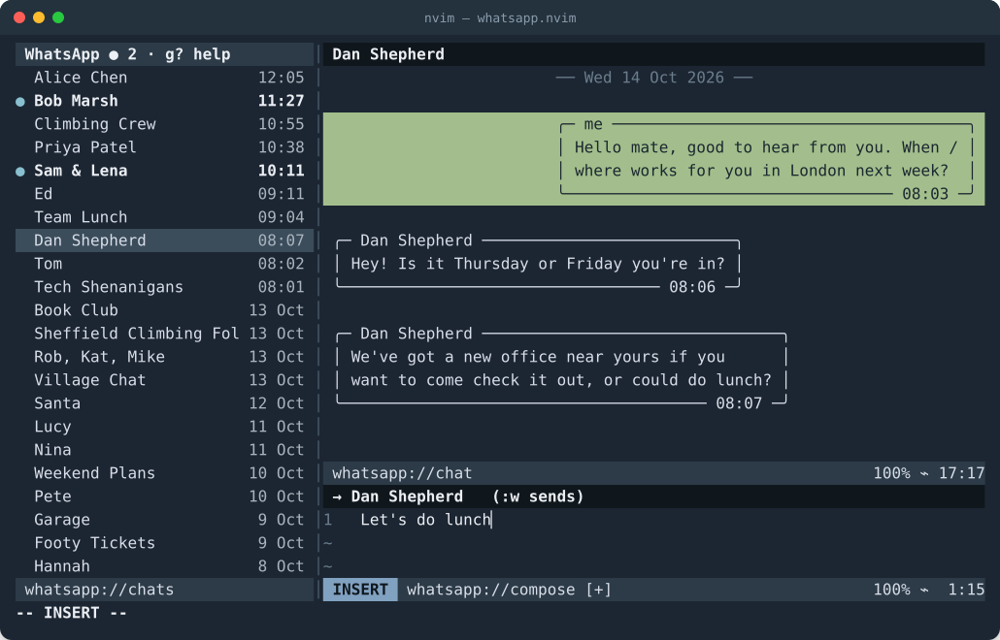

# whatsapp.nvim

WhatsApp in Neovim. Hand-written without AI support in less than 200 bytes of Bash (see [`whatsapp.nvim.sh`](./whatsapp.nvim.sh)). Experimental compiler so use at your own risk.



## Quickstart

Install via your favourite plugin manager:

```vim
" vim-plug
Plug 'dwmkerr/whatsapp.nvim', { 'rtp': 'nvim', 'do': 'make -C nvim' }
```

```lua
-- lazy.nvim
{
  "dwmkerr/whatsapp.nvim",
  build = "make -C nvim",
  config = function()
    vim.opt.rtp:append(vim.fn.stdpath("data") .. "/lazy/whatsapp.nvim/nvim")
    require("whatsapp").setup()
  end,
}
```

Run `:WhatsApp pair`, then go to WhatsApp > Settings > Linked Devices to scan the QR code and pair. Run `:WhatsApp` at any time to open the WhatsApp view.

## Building from Source

Check [`whatsapp.nvim.sh`](./whatsapp.nvim.sh) to build from source. For convenience, the pre-compiled version is in the [`./nvim/`](./nvim) folder.

## Developer Guide

Run from a local clone:

```sh
git clone https://github.com/dwmkerr/whatsapp.nvim.git
cd whatsapp.nvim
# Compile the plugin (needs go and lua).
make -C nvim build        # needs Go and a C compiler

# Don't forget to change vimrc/nvim config to:
# Plug '~/repos/whatsapp.nvim', { 'rtp': 'nvim', 'do': 'make -C nvim' }
```

`make -C nvim test` runs the Go and Lua tests. Plugin layout, bridge protocol and options are in [`nvim/README.md`](./nvim/README.md).

## Other Notes

This is built using the unofficial client [whatsmeow](https://github.com/tulir/whatsmeow), as noted on that repository it is possible that this might violate the WhatsApp terms of service. Also, the compiled version used the codex/Astra compiler and comes with the least possible warranty.
